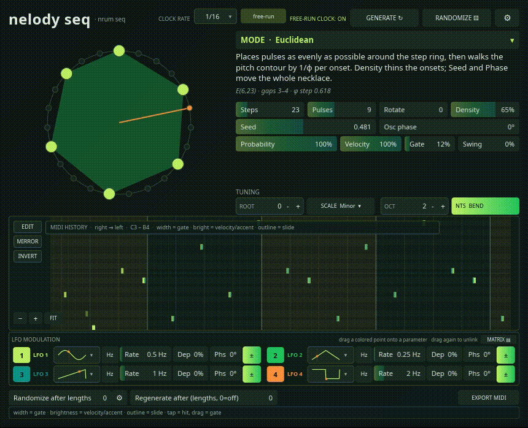

# nelody seq

**Algorithmic melodic MIDI sequencer (CLAP + VST3), written in Rust.**




So... first of all: **Heavy LLM Coding, architecture human-planned & tested, maintained and used.** 

**This is an EARLY phase! 
Clock, generation, mode logic/function-wise, aswell as overall architecture and documents will be updated/polished over time.**

**The actual version is in concept & preperation status.**

nelody seq is the melodic sibling of [nrum seq](https://github.com/ccne4mocc): the same
architecture and editor layout, but with one mono, 303-style voice and a right-to-left piano roll
instead of an eight-lane drum matrix. It generates **notes, not percussion**, over MIDI channel 1.
Route the track to a mono synth and use the plug-in as a generative player.


## Download

Prebuilt Linux and Windows bundles are on the
[latest release](https://github.com/ccne4mocc/nelody-seq/releases/latest). Linux is the primary
target; the Windows build is experimental.

```sh
tar -xzf nelody-seq-*-linux-x86_64.tar.gz
mkdir -p ~/.clap ~/.vst3
cp -r nelody-seq.clap ~/.clap/
cp -r nelody-seq.vst3 ~/.vst3/
```

On Windows, unzip and copy `nelody-seq.clap` and `nelody-seq.vst3` into
`C:\Program Files\Common Files\CLAP` and `C:\Program Files\Common Files\VST3`.
More details and install notes: [ccne4mocc.github.io](https://ccne4mocc.github.io/).

## Motivation

This plugin grew out of lot of interessents in the last years, especially by starting to teach myself piano play and getting my head stuck in endless rabbit holes in music production & electronic music (and birds... and sound design... and music theory and so on lol). I was kinda unsatisfied with sequencers and generative stuff, also some where really unstable (looking at you HY-RPE), on the other side a variaty of plugins/software like strudl, supercollider and some other euclidian sequencers were awesome and really hooked me.

Everything is deterministic and bounded for a given parameter snapshot and seed, so a pattern can be recalled, automated and exported. It allows for basic midi pattern creation out base pattern application, aswell as polymetric and polyrythm methods, acid slides, mode-pattern corresponding parameter modulation (still some infos/descriptions open to do for in-plugin clarity). High step ceiling to have fun with the *ähem* deterministic drawing / sequencer style -> just for the pleasent moments with some modes, their pattern logic, and it's visualization :3 try for first funny eye-brain-shenanigan (examples taken out of nrun cause I like writting but am still lazy)s: 
-> raised-cos threshold: with heigh steps/envelope cycle values,
-> euclidian-swing-hybrid: low/high steps, increase pulses.
-> arnold circle map: set steps whatever low/high, play around with rotation/coupling K values increasing/decreasing.
-> sturmian word: word slop automation makes funny suns :>
-> if you never saw cellular automatons: 8-100 steps, move around teh CA rule slider/parameter (yes that's this).
... and so on...

The plugin still needs polish and I'm also planning to add more modes from time to time and partially cleanup/slim-down. Also it can get  confusing with higher parameter values and some combinations, depending on modes. Nevertheless, having the limits loose was more fun (step ceiling can be increased in settings). Optimizing and giving more depth in the view/presentation is also somewhere on the list (first 1D/2D more work, but also 3D ideas). 
It's quite possible that I will smack both plugins into 1 in future, especially cause of agentic/coding workflows I'm trying around... let's see with further polishment.

The windows variants are experimental, my focus is mainly on linux but they worked with my tests.

Enjoy :3

## Highlights

- **30 generators**: 25 melodic algorithms plus 5 acid lines with accent, slide and octave-jump
  controls.
- **Up to six voices** with legato, retrigger, slide and accent behaviour. Voice 0 is the historic mono line; NTS voices use separate MIDI channels for independent bends.
- **Microtonal tuning**: root pitch class, scale and just-intonation tables, root-cents fine tune,
  and any EDO up to 72. Non-12-TET pitch is sent as pitch bend.
- **MIDI history / editor roll** with per-step hit, probability, accent, ratchet, timing and gate
  overrides, plus undo/redo and persistence through the project state.
- **Four runtime LFOs** with waveform, Hz or beat clock, depth, phase and polarity (UI currently
  hidden while the rack is reworked; parameters, links and audio behaviour remain live).
- **One-loop MIDI export** using the same generation path as the audio scheduler.
- **Mode-aware Randomize** with a scope mask and built-in starting points.
- **Four themes**, with Forest as the fresh default.

## Modes

The 30 generators use the same category taxonomy as nrum seq, plus the Acid group. The full
mapping, derivation and view geometry live in
[`docs/REFERENCE_MAPPING.md`](docs/REFERENCE_MAPPING.md).

| Category | Modes | Count |
|---|---|---:|
| Rhythm | Euclidean · Oscillator / Phase · L-System Grammar | 3 |
| Stochastic | Mozart Dice · Markov Walk · Probabilistic (Bernoulli) · Brownian Walk · Lévy Flight | 5 |
| Chaos / Physics | Logistic Map · Arnold Circle Map · Tent Map · Hénon Map | 4 |
| Fractal | — (reserved, currently empty) | 0 |
| Cellular | Cellular Automaton · Life-like CA | 2 |
| Geometric | Eulerian Walk · Hilbert Curve | 2 |
| Number Theory | Golomb Ruler · Xenakis Sieve · Fibonacci / Sturmian · Thue-Morse · Rudin-Shapiro · Ulam Spiral Primes | 6 |
| Music Theory | Tonnetz Walk · Arpeggiator · Walking Bass | 3 |
| Acid | Acid Random · Acid Euclid · Acid Markov · Acid Motif · Acid Shift Register | 5 |
| **Total** | | **30** |

## Quick start

1. Build the plug-in (see [Build](#build)).
2. Place the CLAP or VST3 on an instrument track and route it to a mono synth.
3. Pick a mode and tuning, then generate or edit a line.
4. Use the piano roll to shape individual steps, or export the loop as MIDI.

nelody seq is a MIDI effect. It does not synthesize audio; without a downstream instrument it
will emit events but produce no sound.

## Keyboard

Every control is reachable without a pointer. The focused control draws a 1 px ring; Tab and
Shift+Tab move between them, and Space or Enter activates the focused one.

| Key | Action |
|---|---|
| `G` | Generate |
| `R` | Randomize |
| `S` | Open or close settings |
| `Esc` | Close the open panel or menu |
| `Tab` / `Shift+Tab` | Next / previous control |

Shortcuts are ignored while a text field has focus, so typing a value never triggers one.

## Generators and editing

The 25 melodic generators cover Euclidean necklaces, Golomb rulers, the logistic map, Eulerian
walks, Arnold circle maps, Mozart dice, Tonnetz walks, Rule-30 and Life-like cellular automata,
Markov walks, oscillator sampling, L-systems, Xenakis sieves, Fibonacci/Sturmian words, Bernoulli
processes, Thue-Morse, Rudin-Shapiro, Brownian walks, Levy flights, tent and Henon maps,
arpeggiators, walking bass, Hilbert curves and Ulam spiral primes. The five acid modes add
Random, Euclid, Markov, Motif and shift-register lines.

The lower roll is both a record of emitted events and a per-step editor. It scrolls
right-to-left, follows the clock automatically, and freezes while an edit mode is active. `NOTES`
mode taps to toggle a hit and drags to resize its gate; `ADV` exposes probability, accent,
ratchet, timing and clear actions. The current loop is overlaid on the recorded history, so
regenerations and transport jumps are visible.

## Tuning

The tuning row controls root pitch class, scale or just-intonation table, EDO divisions (only for
Equal EDO), octave range and the NTS pitch-bend toggle. A root-cents field provides fine tuning.
Pitch bend is announced over RPN 0 so the receiving synth can match the plug-in's range, and the
bend is reset to centre when the voice stops.

## Modulation

Four LFOs are still computed: each has a waveform, Hz or beat-synced speed, depth (0–200%),
phase, polarity and an enable toggle, and links persist with the project. The 2×2 rack and the
modulation matrix are hidden for now while that UI is reworked, so existing links keep modulating
but cannot be created or edited in the plug-in.

I highly recommend to work with your LFOs in your DAW.

## Build

Requirements: Rust 1.90 or newer, a C/C++ build toolchain, and the usual Slint windowing
dependencies on Linux.

```sh
cargo check --lib
cargo test --lib
cargo xtask bundle nelody-seq --release
```

The bundle command writes `target/bundled/nelody-seq.clap` and
`target/bundled/nelody-seq.vst3`.

The `nice-plug` dependency is pinned to a commit in the
[`ccne4mocc/nice-plug`](https://github.com/ccne4mocc/nice-plug) fork. It adds bounded state
loading, parameter rescans after state load, and tolerant VST3 activation before
`setupProcessing()`.

## Compatibility

The 1.0.x line uses the host identity `com.nelodyseq.nelodyseq` (CLAP) and `nelody-seq` (VST3 class
ID). Sessions created with the old `com.nelody.nelody` / `Nelody` IDs must replace the plug-in
instance.

## Status and limitations

- Not release-certified. The automated CLAP and Carla checks pass; every DAW still needs a manual
  smoke test.
- `clap-validator` passes 33 tests with 11 skipped and 0 failures on the pinned `nice-plug` fork.
  `pluginval` has not been run.
- The Linux bundles build and their shared libraries resolve cleanly. Windows bundles are built
  by the `Bundles` workflow on `v*` tags or manual dispatch, but have not been verified on real
  hardware; macOS is not configured.
- Fixed UI size (860×697).
- Screen readers are a decided gap for this release: the controls declare roles and labels, but the
  vendored Slint backend produces no accessibility tree. Keyboard operation and visible focus are
  complete; see `docs/ACCESSIBILITY.md`.
- MIDI export writes one loop and uses the plug-in process working directory, not the DAW project
  path.
- Microtiming is step-wide and only positive delays are scheduled.

## Project layout

```text
src/
  lib.rs              parameters, transport scheduler, CLAP/VST3 exports
  modes.rs            generator list and host metadata
  editor.rs           Slint adapter and host parameter callbacks
  history.rs          lock-free note history ring
  edits.rs            per-step edit overlay and undo/redo
  globals.rs          shared state and user-global settings
  help.rs             mode descriptions and formulas
  modulation.rs       LFO clocks, signals and link masks
  randomize.rs        mode-aware randomization vocabularies
  midi_export.rs      Standard MIDI File writer
  tuning.rs           scales, EDO and pitch mapping
  view.rs             pure geometry for every panel
  sequence/           one generator per file, each with unit tests
ui/app.slint          Slint widgets, layout and piano roll
docs/                 architecture, tuning, verification and research notes
xtask/                bundle and assembly runner
vendor/               vendored Slint/baseview adapter
```

## Documentation

| Document | Contents |
|---|---|
| [`docs/README.md`](docs/README.md) | Documentation index |
| [`docs/ARCHITECTURE.md`](docs/ARCHITECTURE.md) | Layers, invariants and data flow |
| [`docs/REFERENCE_MAPPING.md`](docs/REFERENCE_MAPPING.md) | Where every mode and view came from |
| [`docs/LFO_SYSTEM.md`](docs/LFO_SYSTEM.md) | LFO clocks, targets, links and persistence |
| [`docs/ACCESSIBILITY.md`](docs/ACCESSIBILITY.md) | Keyboard operation and the screen-reader gap |
| [`docs/HOST_VERIFICATION.md`](docs/HOST_VERIFICATION.md) | What has actually been tested |
| [`docs/RELEASE_CHECKLIST.md`](docs/RELEASE_CHECKLIST.md) | Release and host smoke-test checklist |
| [`docs/CHANGELOG.md`](docs/CHANGELOG.md) | Release notes |

## Credits and license

- Author: `ccne4mocc / feN`
- Copyright (C) 2026 ccne4mocc / feN
- License: **GPL-3.0-or-later** (see [LICENSE](LICENSE)).

## Support

<a href="https://buymeacoffee.com/awpe6kbwk9">
  
</a>
